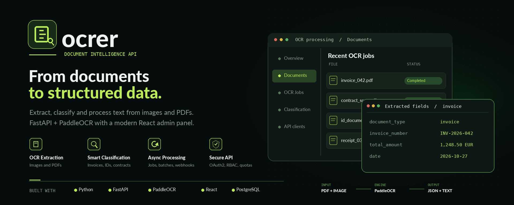

# Ocrer — documentación técnica

Esta carpeta reúne la documentación técnica de Ocrer. Explica la arquitectura
implementada, los límites actuales respecto a DDD / Clean Architecture / puertos
y adaptadores, y la topología operativa. Complementa la guía de uso del
[README principal](../README.md).

## Documentos

- [Landing de GitHub Pages](index.html): presentación del sistema y accesos a la documentación.
- [Arquitectura](architecture.md): componentes, dependencias, flujos, decisiones y patrones.
- [Backend](backend.md): organización FastAPI, OCR, CQRS y persistencia.
- [Frontend](frontend.md): aplicación React y comunicación con la API.
- [Operación y seguridad](operations.md): Docker Compose, configuración, workers y límites de confianza.

## Fuente de verdad

Estos documentos describen el código actual, no una arquitectura objetivo. Al
cambiar una ruta, un flujo o una decisión operativa, actualiza el documento
correspondiente junto con el código. Los valores de configuración viven en
`backend/app/config.py` y `.env.example`; las rutas se registran en
`backend/app/main.py`.

GitHub Pages se publica desde `doc/` mediante
`.github/workflows/pages.yml`. En GitHub, configura **Settings → Pages → Build
and deployment → GitHub Actions**. La URL esperada es
`https://venturaproject.github.io/ocrer/`.
